# UTS Pemrograman Web 1 - Aplikasi Pemesanan Buku "BukuKu"

| | |
|---|---|
| **Nama** | Muhamad Prasetyo Andri Wibowo |
| **NIM** | 312510181 |
| **Kelas** | I251B |
| **Program Studi** | Teknik Informatika, Universitas Pelita Bangsa |
| **Mata Kuliah** | Pemrograman Web |

## Deskripsi Project

BukuKu adalah aplikasi web front-end sederhana untuk pemesanan buku pada toko online. Seluruh data (katalog, pengguna, pengiriman, riwayat) diambil dari variabel JavaScript pada `js/data.js` berformat Array JSON, tanpa server atau database. Data yang berubah saat aplikasi dipakai (stok baru, pesanan, akun terdaftar) disimpan di `localStorage` browser agar tetap ada ketika berpindah halaman.

**Teknologi:** HTML5 semantik, CSS3 (inline, internal, dan external), JavaScript (DOM, event, validasi form, modal, alert).

**Akun uji (dari `dataPengguna`):** `rina@gmail.com` / `rina123` (User) atau `siti@gmail.com` / `siti123` (Admin)

## Struktur Folder

```
tugas-uts-web1/
|-- index.html        (halaman login)
|-- dashboard.html
|-- stok.html
|-- tracking.html
|-- checkout.html
|-- css/
|   |-- style.css
|-- js/
|   |-- script.js
|   |-- data.js
|-- assets/
|   |-- logo.png (opsional)
|-- img/
|   |-- pengantar_komunikasi.jpg, manajemen_keuangan.jpg, dst. (sesuai field cover)
|-- screenshots/      (tangkapan layar untuk README)
```

Catatan: sesuai struktur folder pada soal, halaman login bernama `index.html`.
Isi `js/data.js` adalah data dari dosen (`dataPengguna`, `dataKatalogBuku`, `dataTracking`) dan dipakai apa adanya. Gambar sampul di folder `img/` memakai nama file sesuai field `cover`. Untuk buku yang ditambahkan lewat form dan belum punya gambar, aplikasi otomatis menampilkan sampul cadangan (SVG) sehingga tampilan tetap rapi.

## Cara Menjalankan

1. Unduh atau clone repository ini.
2. Buka `index.html` di browser (tidak perlu server).
3. Login dengan akun uji di atas, atau daftar akun baru lewat tombol **Daftar**.

## Penjelasan dan Hasil Tiap Proses

### 1. Halaman Login (`index.html`)

Form berisi email dan password dengan tombol **Login**. Validasi dilakukan di sisi klien: kolom kosong dan format email yang salah memunculkan pesan merah di bawah kolom. Jika email atau password tidak cocok dengan `dataPengguna`, muncul `alert("Email/password yang anda masukkan salah")`. Tombol **Lupa Password** dan **Daftar** membuka modal box. Pendaftaran memvalidasi nama, email unik, panjang password, dan kecocokan konfirmasi password.

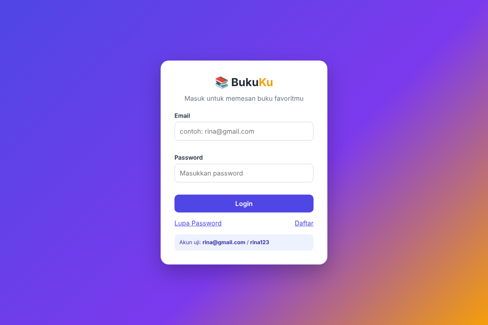

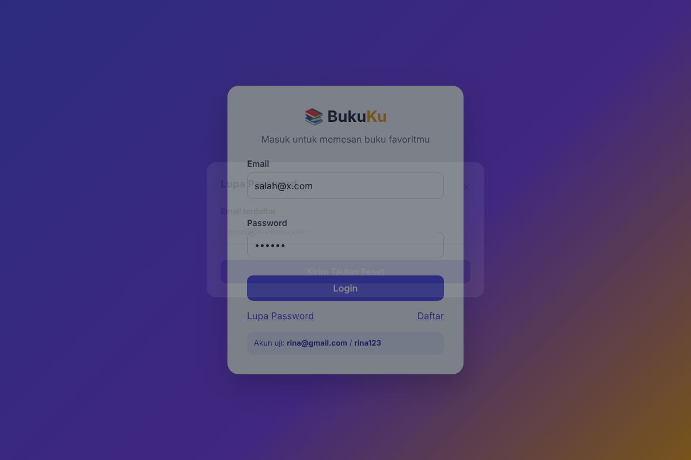

### 2. Dashboard (`dashboard.html`)

Menampilkan sapaan berdasarkan waktu lokal perangkat (pagi, siang, sore, malam) lengkap dengan jam yang berjalan, ringkasan angka, dan empat tombol menu: Informasi Stok/Katalog, Tracking Pengiriman, Laporan Pemesanan, dan History Transaksi. Dua menu terakhir tampil sebagai modal berisi tabel yang dibuat dengan DOM dari `dataTracking` dan pesanan baru: Laporan Pemesanan merekap jumlah dan nilai pesanan per ekspedisi, History Transaksi menampilkan semua nomor DO beserta statusnya. Peran akun (User/Admin) ditampilkan di hero.

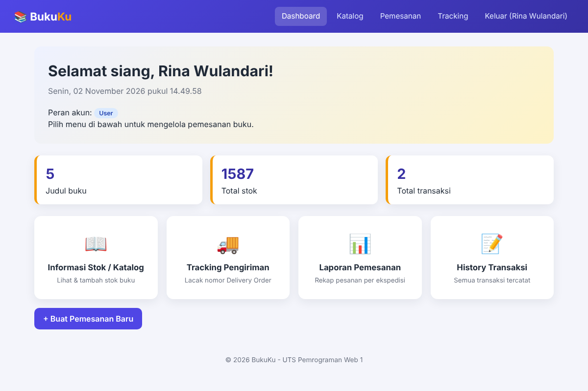
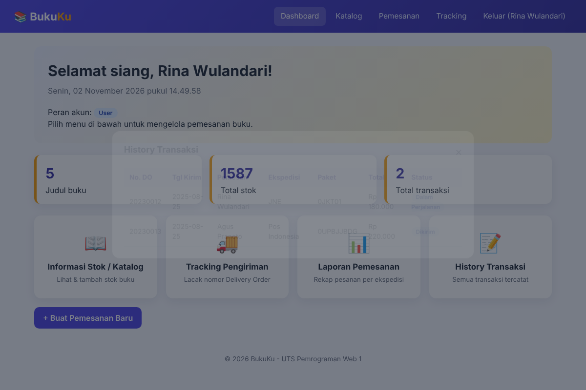
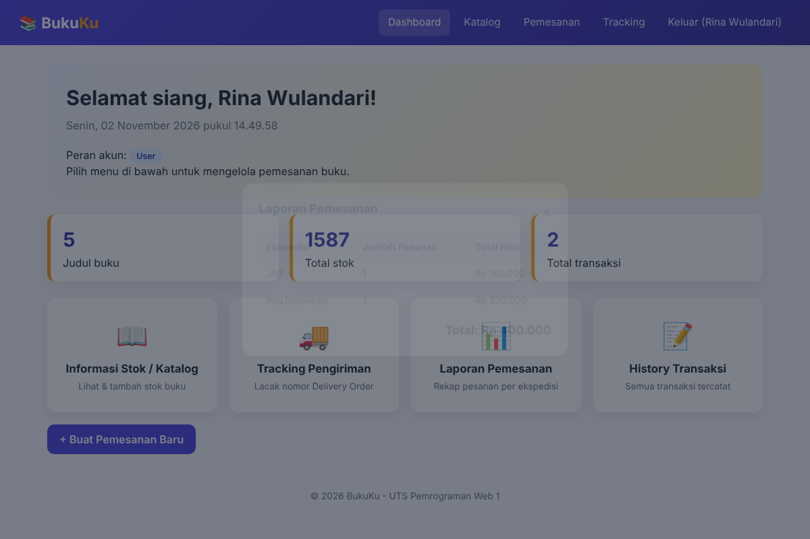

### 3. Informasi Stok / Katalog (`stok.html`)

Tabel dibuat secara dinamis dari konstanta `dataKatalogBuku` di `data.js` (kode, nama barang, jenis, edisi, harga, stok, cover). Tersedia pencarian, filter jenis, penghapusan baris, dan fitur **Tambah Stok Baru** yang membuat baris baru lewat DOM setelah lolos validasi (format kode 4 huruf + 4 angka seperti `EKMA4999`, kode tidak boleh ganda, edisi, harga, dan stok valid). Stok kurang dari atau sama dengan 50 diberi penanda "menipis".

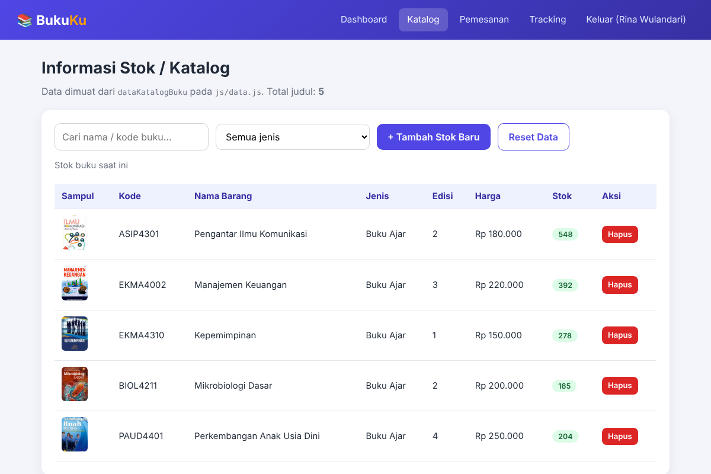
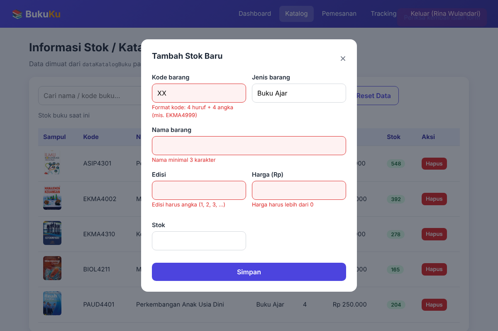
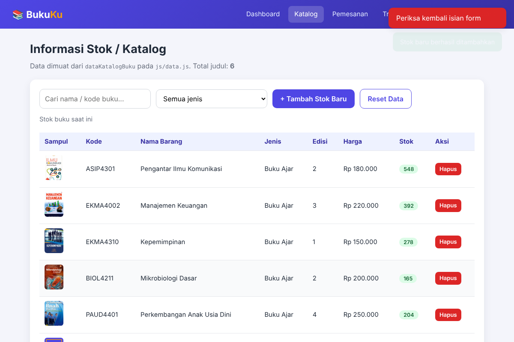

### 4. Pemesanan (`checkout.html`)

Pengguna memilih buku dan jumlah, lalu menambahkannya ke keranjang. Jumlah dapat diubah dan baris dapat dihapus, dengan total yang dihitung ulang otomatis dan dibatasi sesuai stok. Harga dibaca dari teks seperti "Rp 180.000" lalu diubah menjadi angka untuk perhitungan. Selanjutnya diisi data pemesan (nama, email, nomor HP, alamat), ekspedisi, dan metode pembayaran. Untuk transfer bank muncul kolom nomor rekening tambahan. Saat berhasil, sistem membuat Nomor Delivery Order (mis. `20260014`) dengan bentuk data yang sama seperti `dataTracking`, mengurangi stok, dan menampilkan modal sukses.

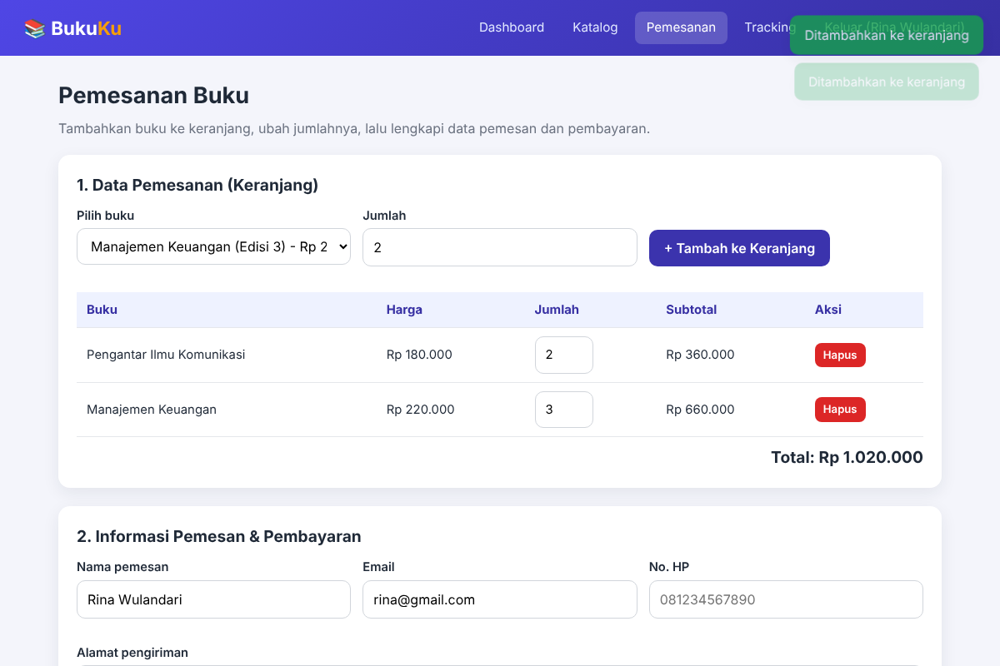
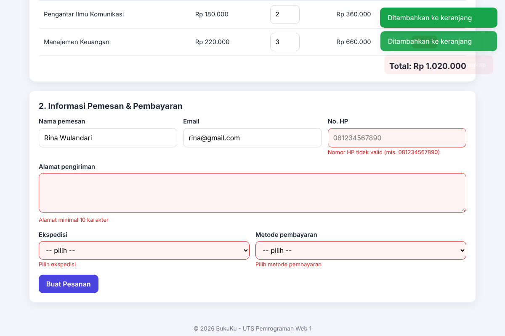
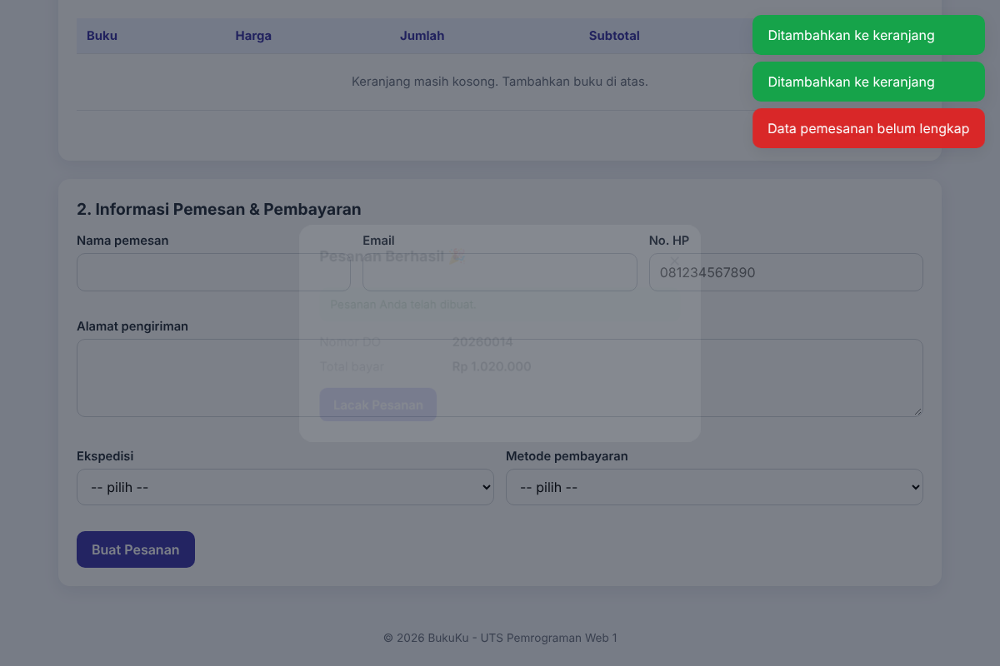

### 5. Informasi Pengiriman (`tracking.html`)

Pengguna memasukkan Nomor Delivery Order lalu menekan **Cari**. Hasilnya berupa nama pemesan, status pengiriman dalam bentuk progress bar lima tahap beranimasi (Pesanan Dibuat, Dikemas, Dikirim, Dalam Perjalanan, Diterima), detail ekspedisi, tanggal kirim, jenis paket, total pembayaran, dan daftar riwayat perjalanan paket dari field `perjalanan`. Nomor yang kosong, bukan angka, atau tidak ditemukan menampilkan pesan error. Nomor DO uji: `20230012` dan `20230013`, serta nomor dari pesanan yang baru dibuat.

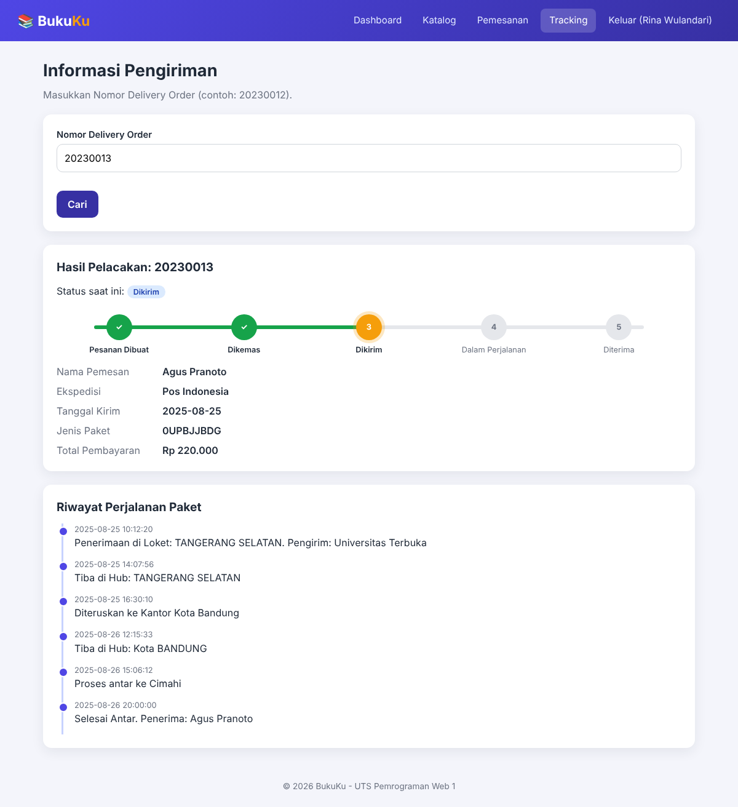
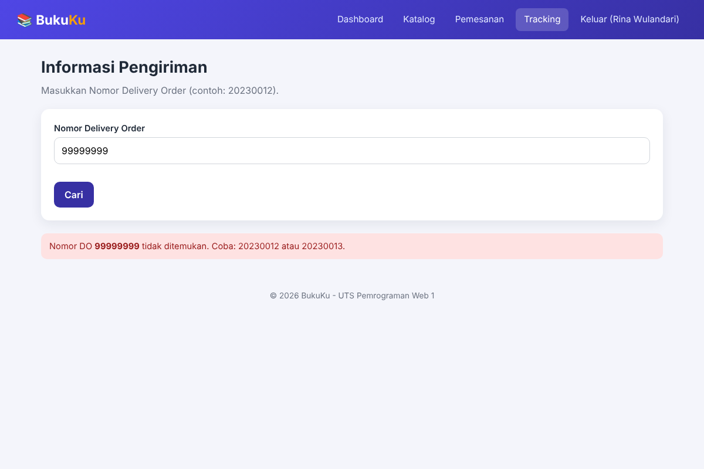

## Pemenuhan Indikator dan Kriteria Penilaian

| Kriteria | Penerapan |
|---|---|
| Struktur HTML semantik, valid, lengkap | `header`, `nav`, `main`, `section`, `footer`, `form` dengan `label`, atribut `lang`, `meta viewport`, dan atribut ARIA pada modal |
| Desain CSS | External (`css/style.css`), internal (`<style>` di `dashboard.html`), dan inline (atribut `style` pada beberapa elemen); variabel CSS, grid, dan tampilan responsif |
| JavaScript DOM | Render tabel dan timeline dinamis, tambah/hapus/ubah baris, filter pencarian, event delegation, progress bar beranimasi |
| Validasi form dan alert | Pesan error per kolom, `alert()` login gagal, `confirm()`, toast, dan modal |
| Modularitas file | HTML, CSS, `script.js`, dan `data.js` terpisah; satu `script.js` dipakai semua halaman lewat atribut `data-page` |
| Kreativitas tambahan | Tema BukuKu, jam lokal, ringkasan dashboard, timeline perjalanan paket, sampul cadangan otomatis, pengurangan stok, nomor DO otomatis |
